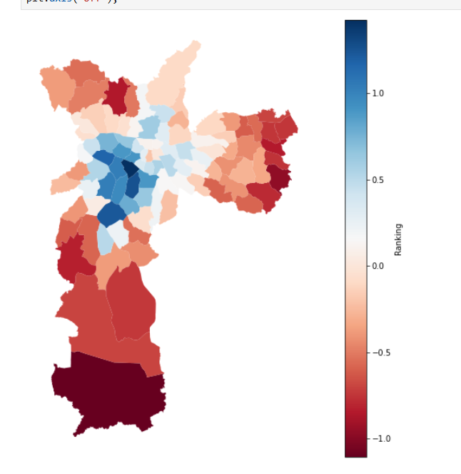

# pca-distritos-sp
Projeto em que aplico Análise de Componentes Principais (PCA) para redução de dimensionalidade e criação de um ranking socioeconômico dos distritos de São Paulo.

# Ranking de Distritos de São Paulo com PCA

Projeto de Data Science desenvolvido com foco em redução de dimensionalidade e análise multivariada não supervisionada.

Base de dados (`distritos_sp.csv`): Contém 96 observações referentes aos distritos da cidade de São Paulo e 9 indicadores numéricos: `renda`, `quota`, `escolaridade`, `idade`, `mortalidade`, `txcresc`, `causasext`, `favel` e `denspop`.

Preparação dos dados: Remoção da coluna de identificação (`cod_ibge`), definição do nome do distrito como índice, verificação de ausência de valores nulos e padronização das variáveis com `StandardScaler` ($\mu = 0$ e $\sigma = 1$) para evitar viés por diferença de escala.

Adequação da amostra: Validação da aplicabilidade da técnica por meio da matriz de correlação de Pearson, do Teste de Esfericidade de Bartlett ($p < 0,05$) e do critério KMO ($0,833$).

Critério de retenção: Aplicação do critério de Kaiser (autovalores $> 1$) e análise da variância explicada acumulada, selecionando os 2 primeiros componentes principais que explicam aproximadamente $75,18\%$ da variância total dos dados.

---

## 🚀 Tecnologias utilizadas

- Python
- Pandas
- NumPy
- Matplotlib
- Seaborn
- Plotly
- Scikit-Learn
- Factor Analyzer

---

## 📊 Etapas do projeto

Análise exploratória (EDA): Inspeção das estatísticas descritivas, verificação de tipos e construção da matriz de correlação entre os 9 indicadores socioeconômicos e demográficos.

Validação estatística para PCA:

- Execução do Teste de Esfericidade de Bartlett para confirmar a existência de correlações significativas entre as variáveis.
- Cálculo da estatística Kaiser-Meyer-Olkin (KMO) global e por variável para avaliar a adequação da amostra.

Padronização e modelagem PCA:

- Padronização das features com `StandardScaler`.
- Ajuste do modelo `PCA` do `scikit-learn` e extração dos autovalores, autovetores e cargas fatoriais (*factor loadings*).
- Seleção do número de componentes via critério de Kaiser e visualização por meio de *Scree Plot* e gráfico de variância acumulada.

Construção do ranking:

- Cálculo dos scores fatoriais e ponderação pela variância explicada de cada componente para gerar o índice composto e ranquear os distritos de São Paulo.

---

## 📈 Resultados obtidos

Os principais indicadores da adequação e redução dimensional foram:

```python
KMO Global: 0.833 (adequação considerada boa/meritória)
Teste de Bartlett: p-valor < 0.05 (rejeita-se a matriz identidade)
Componentes retidos (Autovalor > 1): 2 componentes
Variância explicada acumulada (2 componentes): 75.18%
```
Visualização do ranking com GeoPandas




---

## 🧠 Principais aprendizados

Neste projeto foram praticados conceitos importantes como:

- padronização de variáveis antes da aplicação de PCA
- testes de adequação fatorial (KMO e Esfericidade de Bartlett)
- interpretação de autovalores, autovetores e cargas fatoriais
- escolha de componentes pelo critério de Kaiser e Scree Plot
- visualização de dados com Seaborn e Plotly
- criação de indicadores sintéticos e rankings multivariados

---

## 📂 Estrutura do projeto

```bash
📁 projeto
 ┣ 📁 dados
 ┃ ┗ 📄 distritos_sp.csv
 ┣ 📄 projeto_pca_geopandas.ipynb
 ┗ 📄 README.md
```

---

## ▶️ Como executar

Clone o repositório:

```bash
git clone https://github.com/FernandoDevelo/projeto-pca-geopandas.git
```

## 👨‍💻 Autor

Projeto desenvolvido por Fernando Nascimento durante os estudos em Data Science e Machine Learning.
